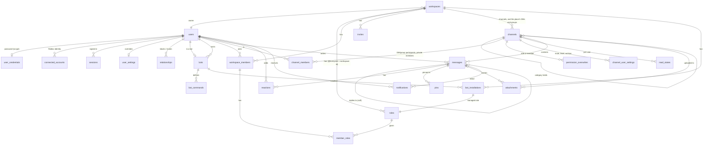

# Database schema

PostgreSQL 15+, UTF8. Defined in [`backend/src/db/schema.ts`](../../backend/src/db/schema.ts);
the SQL is in [`backend/migrations`](../../backend/migrations).

- **IDs** are 64-bit snowflakes in `bigint` columns ([MESSAGES.md](MESSAGES.md)),
  except `jobs.id` (a sequence) and `invites.code` (a random string).
- **Times** are `timestamptz`.
- **Workspace channels and conversations share `channels`**, so every
  message has one channel id and one ID space, as on Discord.

## Entity relationships



`audit_log` and `jobs` stand alone (they reference ids without foreign keys,
so they outlive what they describe).

## Tables

### People

| Table | Holds | Notes |
|---|---|---|
| `users` | id, username, display name, avatar, status (`active`, `suspended`, `deleted`), `is_bot`, created, last active, deleted | Usernames unique without case (`lower(username)` index) |
| `user_credentials` | scrypt password hash | Only for password accounts |
| `connected_accounts` | provider (`roblox`), provider user id and name | Unique per provider id: one Roblox account, one user |
| `sessions` | SHA-256 of the token, expiry, last use, IP, user agent, revoked | The token itself is never stored |
| `user_settings` | JSON of what differs from the defaults, a version | Defaults live in code (`modules/settings/defaults.ts`) |
| `relationships` | (user, target, `block` or `mute`) | |

### Workspaces

| Table | Holds | Notes |
|---|---|---|
| `workspaces` | name, description, icon, owner, settings, team chat channel, and for a Roblox place its key and the SHA-256 of the proof of its secret (`sha256(sha256(secret))`) | Soft delete (`deleted_at`); `place_key` unique: one workspace per place |
| `roles` | name, color, position, permission bits, mentionable, `managed` | @everyone has the workspace's id; `managed` roles belong to bots |
| `workspace_members` | (workspace, user), nickname, joined | |
| `member_roles` | (workspace, user, role) | FK to the membership: leaving removes them |
| `invites` | code, uses, max uses, expiry, inviter | Uses counted atomically |

### Channels and conversations

| Table | Holds | Notes |
|---|---|---|
| `channels` | type (`text`, `category`, `dm`, `group_dm`), workspace, parent category, name, topic, icon, position, private, slowmode, group owner, `dm_key`, last message id | Text channels and categories always have a workspace; DMs and groups may (a place's) or may not. `dm_key` (`"[<workspace id>:]<low id>:<high id>"`) makes a pair's DM unique per workspace. Workspace channel lists never include its conversations |
| `channel_members` | (channel, user) | DM and group participants; members of private channels |
| `permission_overwrites` | (channel, role or member, allow bits, deny bits) | |
| `channel_user_settings` | one user's mute (until), notification level, archive for one channel | |
| `read_states` | last read message id, mention count, per user and channel | Only moves forward |

### Messages

| Table | Holds | Notes |
|---|---|---|
| `messages` | channel, author, type, content (≤ 4000), flags, reply-to id, mentioned user ids, @everyone, embeds, components, metadata, client nonce, created, edited, deleted, `search` (generated `tsvector`) | See below |
| `reactions` | (message, emoji, user) | One per person per emoji |
| `pins` | (channel, message), who, when | At most 50 per channel |
| `attachments` | channel, message, uploader, file name, MIME type, size, storage key, status (`pending`, `uploaded`, `deleted`) | Bytes are in S3, never in Postgres |

**Indexes on `messages`:**

| Index | For |
|---|---|
| primary key `id` | One message; ordering by time |
| `(channel_id, id desc)` | Channel history, pagination, unread counts |
| `(author_id, id desc)` | A user's messages, search by author |
| GIN on `mentions` | "Messages mentioning me" |
| GIN on `search` | Full-text search |
| unique `(author_id, nonce)` where nonce isn't null | Retried sends don't duplicate |

### Bots

| Table | Holds | Notes |
|---|---|---|
| `bots` | owner, description, public, status, SHA-256 of the token, events URL, subscribed events, **encrypted** signing secret, requested permissions, config | The bot's profile is its `users` row |
| `bot_commands` | name, description, options; global or for one workspace | Unique per (bot, workspace, name), nulls equal |
| `bot_installations` | (workspace, bot), its managed role, installer | |

### System

| Table | Holds |
|---|---|
| `notifications` | user, type (`mention`, `reply`, `direct_message`), channel, message, actor, read; unique per (user, message, type) so retried jobs don't duplicate |
| `audit_log` | action, actor, workspace, target, data, IP |
| `jobs` | type, payload, run at, attempts, lock, last error, dedupe key |

## Retention and cascades

Nothing a person cares about disappears through a cascade. Foreign keys to
`users`, `workspaces`, `channels` and `messages` are `RESTRICT` unless the
child row means nothing without its parent.

| Deleted | Immediately | Afterwards (background jobs) | Kept |
|---|---|---|---|
| **Message** | Content, embeds, mentions wiped; reactions and pins removed; files marked deleted | File bytes deleted from storage | The row as a tombstone, so replies and ids stay valid |
| **Channel** | Hidden (`deleted_at`); child channels move to the top level | `channel.purge`: messages deleted 500 at a time, then files, read states, overwrites, members | The channel row (tombstone) |
| **Group conversation** | Removed member's read state and settings; ownership passes to the longest member | When the last person leaves: purged like a channel | |
| **Workspace** (owner only) | Hidden | `workspace.purge`: its channels hidden and purged one by one; members, roles, invites, bots removed | The workspace row |
| **User account** | Name and profile cleared (shown as "Deleted User"), password, Roblox link, sessions, settings, blocks removed; leaves workspaces and groups; their bots deleted the same way | | Their messages, and their 1:1 DMs for the other person. Refused while they own a workspace |
| **Bot** | Uninstalled everywhere, token invalid, profile cleared | | Its messages |
| **Pending upload** | | Deleted after 24 hours | |
| **Sessions, failed jobs** | | Removed 30 days after expiring or failing | |

Purge jobs check that their target is really deleted before touching
anything, and work on one channel id at a time, so a replayed or mistaken
job can't remove other data.

## Migrations

Drizzle Kit generates SQL migrations from `schema.ts`:

```bash
npm run db:generate -- --name add_something   # writes migrations/NNNN_add_something.sql
```

Review the SQL, commit it, and it runs on the next start (or `npm run migrate`).
Migrations run inside a transaction holding an advisory lock, so instances
starting together apply them once. Write changes so the previous version
still runs against the new schema (add, backfill, then remove in a later
release), so rolling deploys never break.
